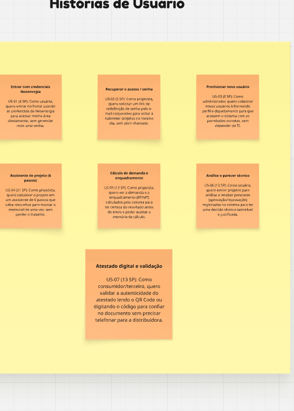
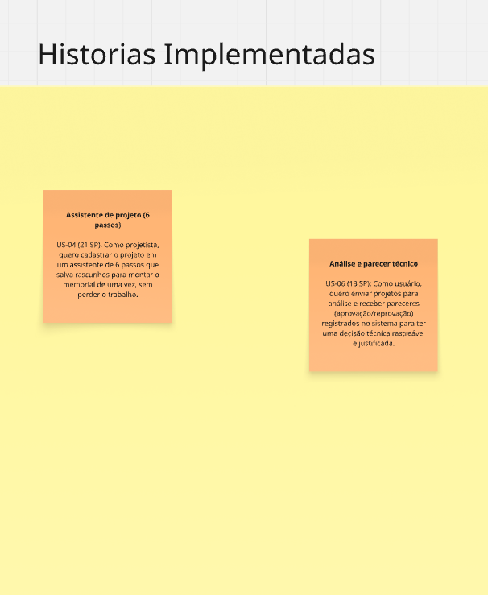
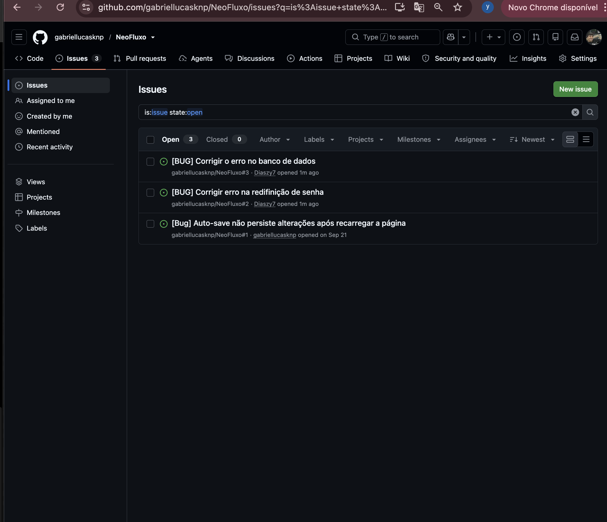

# Portal de Projetos Elétricos - Neoenergia Pernambuco

## 📖 Descrição do Projeto
O Portal de Projetos Elétricos é uma solução desenvolvida pela equipe **Neofluxo** voltada para a otimização, submissão e análise de projetos elétricos da Neoenergia Pernambuco. O sistema foi pensado para centralizar o fluxo de aprovação e acompanhamento de projetos, com foco em maior transparência, rastreabilidade e eficiência operacional.

## 👥 Equipe Neofluxo

| Nome Completo | Papel no Projeto | E-mail (Cesar School) |
| :--- | :--- | :--- |
| **Kaio Cerqueira** | Scrum Master | kcss@cesar.school |
| **Mateus Xavier** | Product Owner | mxrr@cesar.school |
| **Felipe Ulisses** | Desenvolvedor Front-End | fucaa@cesar.school |
| **Jailson de Souza** | Desenvolvedor Front-End | jsj3@cesar.school |
| **Lucas Rogério** | Desenvolvedor Front-End | lrmb@cesar.school |
| **Gabriel Dias** | Desenvolvedor Back-End | gdmm@cesar.school |
| **Lucas Farias** | QA / Desenvolvedor Back-End | lcf2@cesar.school |
| **Gabriel Lucas** | Desenvolvedor Back-End / DevOps | glss@cesar.school |

## 🛠 Tecnologias Usadas
* **Design e Prototipação:** Figma e Miro
* **Front-end:** TypeScript / JavaScript & React JS
* **Back-end:** Java & Spring Boot
* **Banco de Dados:** MySQL
* **Conteinerização:** Docker
* **Deployment:** Render
* **Versionamento de Código:** Git & GitHub
* **IDEs:** VS Code & IntelliJ

---

## 🚀 Entregas

### Entrega 01: Concepção, Histórias de Usuário e Protótipo Lo-Fi

# Histórias de Usuário - Portal de Projetos Elétricos

## Perfis de Usuário
* **Projetista:** Engenheiro eletricista que submete o projeto; monta o memorial de cargas e envia para análise.
* **Analista:** Analista técnico da Neoenergia; aprova ou reprova o projeto.
* **Administrador:** Responsável pela norma e parâmetros; gerencia usuários, fatores de demanda e transformadores.
* **Consumidor / terceiro:** Sem login; valida a autenticidade do atestado.

---

### US-01 — Acesso ao portal e direcionamento por perfil

**Como** projetista, analista ou administrador cadastrado no Portal de Projetos Elétricos da Neoenergia  
**Eu quero** acessar o sistema com minhas credenciais e ser direcionado para uma área exclusiva de acordo com meu perfil  
**Para que** eu tenha acesso às funcionalidades e informações correspondentes às minhas responsabilidades dentro do portal.

* **Cenário 1: Projetista acessa sua área exclusiva**
  * **Dado** que possuo uma conta ativa com perfil de projetista
  * **Quando** informo meu e-mail e senha corretamente na tela de login
  * **Então** sou direcionado ao painel do projetista, com acesso às funcionalidades disponíveis para meu perfil.

* **Cenário 2: Analista acessa sua área exclusiva**
  * **Dado** que possuo uma conta ativa com perfil de analista
  * **Quando** realizo a autenticação com sucesso
  * **Então** sou direcionado ao painel do analista, com acesso às funcionalidades de análise de projetos.

* **Cenário 3: Administrador acessa sua área exclusiva**
  * **Dado** que possuo uma conta ativa com perfil de administrador
  * **Quando** realizo a autenticação com sucesso
  * **Então** sou direcionado à área administrativa, com acesso às funcionalidades de gerenciamento do portal.

---
## US-02 — Recuperar o acesso / senha
**Como** projetista que acessa o portal poucas vezes por mês e esqueceu a senha  
**Eu quero** solicitar um link de redefinição pelo e-mail corporativo e cadastrar uma nova senha  
**Para que** eu volte a submeter projetos no mesmo dia, sem precisar abrir chamado no suporte.

* **Cenário 1: Solicitar o link**
  * **Dado** que estou na tela de login e não lembro minha senha
  * **Quando** clico em "Esqueci minha senha", informo meu e-mail corporativo e confirmo
  * **Então** recebo o e-mail com o link de redefinição em até 5 minutos.

* **Cenário 2: Redefinir com token válido**
  * **Dado** que recebi o e-mail de redefinição há menos de 60 minutos
  * **Quando** abro o link, informo a nova senha atendendo à política e confirmo
  * **Então** vejo "Senha redefinida com sucesso" e sou levado ao login.

---

## US-03 — Provisionar novo usuário
**Como** administrador do Portal de Projetos Elétricos  
**Eu quero** cadastrar um novo usuário informando nome, e-mail corporativo, perfil e departamento  
**Para que** o profissional passe a acessar o sistema já com as permissões corretas do seu papel, sem depender da TI.

* **Cenário 1: Cadastrar novo projetista**
  * **Dado** que estou logado como administrador
  * **Quando** clico em "Novo Usuário", preencho os dados com o perfil "Projetista" e salvo
  * **Então** o usuário aparece na lista com status Ativo e passa a autenticar com o perfil correto.

* **Cenário 2: Alterar o perfil de um usuário**
  * **Dado** que estou logado como administrador
  * **E** existe um usuário ativo com perfil "Projetista"
  * **Quando** edito o usuário, altero o perfil para "Analista" e salvo
  * **Então** no próximo login dele o menu passa a ser o de análise e a ação fica no log de auditoria.

---

## US-04 — Assistente de projeto (6 passos)
**Como** projetista responsável por um empreendimento  
**Eu quero** cadastrar os dados do projeto, unidades e cargas em um assistente guiado que salva rascunhos  
**Para que** eu monte o memorial de cargas de uma só vez, sem perder o trabalho caso precise parar no meio.

* **Cenário 1: Rascunho é criado ao concluir o passo 1**
  * **Dado** que preenchi todos os campos obrigatórios de "Dados do Projeto"
  * **Quando** clico em "Continuar"
  * **Então** avanço para "Unidades Consumidoras" e o projeto aparece em "Meus Projetos" com status Rascunho.

* **Cenário 2: Retomar rascunho no passo em que parei**
  * **Dado** que tenho um rascunho salvo no passo 3 (Cargas de Serviço)
  * **Quando** abro esse projeto na lista e clico em "Continuar edição"
  * **Então** o assistente abre diretamente no passo correspondente com os dados preenchidos.

---

## US-05 — Cálculo de demanda e enquadramento
**Como** projetista que hoje calcula a demanda em planilha  
**Eu quero** ver a demanda total e o enquadramento (BT/MT) calculados pelo sistema baseados na norma vigente  
**Para que** eu tenha certeza do enquadramento antes de enviar o projeto e possa defender o número.

* **Cenário 1: Enquadramento em Baixa Tensão**
  * **Dado** que meu projeto tem demanda calculada de 68,4 kW
  * **Quando** o cálculo é concluído no passo 4
  * **Então** vejo a etiqueta "Baixa Tensão" e a subestação não é exigida.

* **Cenário 2: Enquadramento em Média Tensão**
  * **Dado** que meu projeto tem demanda calculada de 82,1 kW
  * **Quando** o cálculo é concluído
  * **Então** vejo a etiqueta "Média Tensão" e o bloco "Dimensionamento da Subestação" torna-se obrigatório.

---

## US-06 — Análise e parecer técnico
**Como** analista técnico da Neoenergia (e como projetista que enviou o projeto)  
**Eu quero** receber/emitir um parecer de aprovação ou reprovação com motivo registrado  
**Para que** exista uma decisão técnica rastreável, com data, autor e justificativa.

* **Cenário 1: Aprovar o projeto**
  * **Dado** que estou analisando um projeto com status "Em análise"
  * **Quando** clico em "APROVAR PROJETO" e confirmo
  * **Então** o projeto passa a "Aprovado", o atestado é emitido e o histórico registra o evento.

* **Cenário 2: Reprovar exige motivo**
  * **Dado** que estou no modal "Confirmar Reprovação"
  * **E** não selecionei nenhum motivo
  * **Quando** tento confirmar
  * **Então** o botão permanece desabilitado com a mensagem "Selecione um motivo."

---

## US-07 — Atestado digital e validação
**Como** consumidor, construtora, prefeitura ou cartório  
**Eu quero** conferir a autenticidade do atestado de projeto escaneando o QR Code ou digitando o código  
**Para que** eu confie no documento sem precisar telefonar para a Neoenergia.

* **Cenário 1: Validar por código digitado**
  * **Dado** que sou um terceiro sem login na página pública de validação
  * **E** tenho em mãos um atestado impresso
  * **Quando** digito o identificador e clico em "Validar"
  * **Então** vejo "Atestado válido" com a data de emissão, responsável técnico e norma.

* **Cenário 2: Validar por QR Code**
  * **Dado** que tenho o atestado impresso em mãos
  * **Quando** escaneio o QR Code com a câmera do celular e abro o link
  * **Então** a página de validação abre já com o resultado positivo exibido na tela.
  
  * * **Documento com as Histórias de Usuário: https://miro.com/app/board/uXjVHyQVgWE=/** 
  
* **Artefatos de Planejamento (Stakeholders):** O planejamento incluiu o mapeamento de engajamento da matriz de stakeholders (Sponsor Executivo, Product Manager, Engenharia/DevOps, UX/Research, T[...]
* **Protótipo Lo-Fi (Figma):** [🎨 Acessar Protótipo no Figma](https://www.figma.com/design/MYT7u40LX8F6TngwXPeniZ/Sem-t%C3%ADtulo?node-id=0-1&t=r8Gwz42SnUNSLBvr-1)
  * O protótipo contempla as jornadas descritas no backlog (cobrindo no mínimo 5 histórias).

* **Screencast de Apresentação:** [▶️ Assistir no YouTube](https://youtu.be/2EkI06RKYJc)
  * Vídeo demonstrando a navegação no protótipo Figma, com a explicação de cada história implementada.

### Entrega 02: Implementação Inicial

#### 1. Priorização das histórias (matriz esforço × impacto)

A priorização das histórias foi realizada utilizando a **matriz esforço × impacto**, com o objetivo de maximizar o valor entregue ao usuário com o menor esforço de desenvolvimento. As histórias com maior impacto e menor esforço foram priorizadas para iniciar a implementação do MVP.

| Prioridade | Impacto | Esforço | Descrição |
| :---: | :---: | :---: | :--- |
| 🔴 **Alta** | Alto | Baixo | Histórias essenciais para o funcionamento inicial do MVP e com maior retorno para o usuário. |
| 🟡 **Média** | Relevante | Moderado | Funcionalidades importantes para melhoria da experiência, porém com menor urgência que as prioritárias. |
| 🟢 **Baixa** | Baixo | Alto | Itens que podem ser realizados em sprints futuras, após a consolidação das funcionalidades principais. |

Com isso, foi possível focar nas entregas que geram maior valor para o produto e para o usuário final no Sprint 1.

#### Histórias de Usuário — Visão Geral (Post-its)



#### Histórias Implementadas



As duas histórias selecionadas e implementadas nesta entrega foram:

<table>
<tr>
<td width="50%" valign="top">

> 🟧 **POST-IT 1 — US-04: Assistente de projeto (6 passos)**
>
> **Como** projetista, **quero** cadastrar o projeto em um assistente de 6 passos que salva rascunhos **para** montar o memorial de uma vez, sem perder o trabalho.
>
> | | |
> |---|---|
> | **Impacto** | 🔴 Alto |
> | **Esforço** | 🟡 Médio (21 SP) |
> | **Status** | ✅ Implementada |

</td>
<td width="50%" valign="top">

> 🟧 **POST-IT 2 — US-06: Análise e parecer técnico**
>
> **Como** usuário, **quero** enviar projetos para análise e receber pareceres (aprovação/reprovação) registrados no sistema **para** ter uma decisão técnica rastreável e justificada.
>
> | | |
> |---|---|
> | **Impacto** | 🔴 Alto |
> | **Esforço** | 🟡 Médio (13 SP) |
> | **Status** | ✅ Implementada |

</td>
</tr>
</table>

Essas histórias representam os primeiros passos do desenvolvimento do MVP e validam a proposta inicial do produto com foco em usabilidade, clareza e entrega de valor ao usuário.

---

#### 2. Ambiente de versionamento atuante

O projeto foi mantido em um ambiente de versionamento ativo, com commits frequentes e realizados diretamente na branch principal (`main`), conforme as boas práticas de desenvolvimento e exigências do processo acadêmico e de produto.

- ✅ Commits realizados com frequência semanal;
- ✅ Histórico de desenvolvimento acessível e documentado;
- ✅ Versionamento centralizado no repositório principal;
- ✅ Evolução contínua do código ao longo do Sprint 1.

---

#### 3. Issue/bug tracker

O acompanhamento de problemas, melhorias e pendências foi realizado por meio do **GitHub Issues**, que foi atualizado e utilizado semanalmente durante a entrega. A ferramenta foi empregada para registrar falhas, priorizar melhorias e acompanhar o fluxo de resolução.

- ✅ Registro de issues e bugs no GitHub;
- ✅ Acompanhamento semanal das pendências;
- ✅ Priorização de correções e melhorias;
- ✅ Organização do fluxo de desenvolvimento e resolução de problemas.

---

#### 4. Screencast da Entrega 02

* **Screencast de Apresentação:** [▶️ Assistir no Google Drive](https://drive.google.com/file/d/1QXp-rNCKwJaxHQiTJ5CekDQ2omMbBI22/view?usp=sharing)
  * Vídeo demonstrando a navegação nas funcionalidades implementadas (US-04 e US-06) no front-end da aplicação.

---

#### 5. Considerações finais

A Entrega 02 consolidou a estrutura inicial do MVP, com a priorização das histórias mais relevantes, implementação das primeiras funcionalidades essenciais e organização do processo de desenvolvimento em sprints.

---

### Entrega 03: Implementação das funcionalidades de cálculo e validação

#### 1. Evolução do MVP

A Entrega 03 teve como objetivo aprimorar o Portal de Projetos Elétricos da Neoenergia, implementando funcionalidades importantes para facilitar o acesso dos usuários e tornar o processo de elaboração e análise dos projetos mais eficiente.

Nesta etapa, foram trabalhadas as funcionalidades de autenticação por credenciais corporativas e cálculo automático da demanda elétrica, buscando reduzir tarefas manuais, melhorar a experiência dos projetistas e garantir maior confiabilidade nas informações apresentadas pelo sistema.

Com isso, o MVP evoluiu para uma solução que facilita tanto o acesso ao portal quanto a tomada de decisões técnicas durante a elaboração dos projetos.

#### 2. Funcionalidades priorizadas

As funcionalidades contempladas nesta etapa foram:

- 🟡 **US-01:** Acesso ao portal utilizando as credenciais da Neoenergia, direcionando o usuário para a área correspondente ao seu perfil.
- 🔴 **US-05:** Cálculo automatizado da demanda elétrica e enquadramento do projeto em Baixa Tensão (BT) ou Média Tensão (MT).

#### 3. Post-its de destaque

<table>
<tr>
<td width="50%" valign="top">

> 🟧 **POST-IT 1 — US-01: Entrar com credenciais Neoenergia**
>
> **Como** projetista, analista ou administrador cadastrado no portal corporativo da Neoenergia,
>
> **Quero** entrar no Portal de Projetos Elétricos utilizando o mesmo e-mail e senha já utilizados,
>
> **Para que** eu consiga acessar diretamente a área correspondente ao meu perfil, sem precisar gerenciar outra senha.
>
> | Critério | Classificação |
> |---|---|
> | **Impacto** | 🟡 Médio |
> | **Esforço** | 🟡 Médio |
> | **Status** | ✅ Implementada |

</td>
<td width="50%" valign="top">

> 🟧 **POST-IT 2 — US-05: Cálculo de demanda e enquadramento**
>
> **Como** projetista que atualmente calcula a demanda em planilhas,
>
> **Quero** visualizar a demanda total e o enquadramento do projeto (BT/MT) calculados pelo sistema com base nas regras definidas,
>
> **Para que** eu tenha mais segurança na classificação do projeto antes de enviá-lo para análise.
>
> | Critério | Classificação |
> |---|---|
> | **Impacto** | 🔴 Alto |
> | **Esforço** | 🟡 Médio |
> | **Status** | ✅ Implementada |

</td>
</tr>
</table>

#### 4. Screencast da Entrega 03

* **Screencast de Apresentação:** [▶️ Assistir no Youtube](LINK AQUI)
  * Vídeo demonstrando a navegação nas funcionalidades implementadas (US-01 e US-05) no front-end da aplicação.
 
* **Screencast de Apresentação:** [▶️ Assistir no Youtube](LINK AQUI)
  * Vídeo demonstrando a navegação nas funcionalidades implementadas (US-01 e US-05) no back-end da aplicação.

---

#### 5. Considerações finais

A Entrega 03 contribuiu para a evolução do Portal de Projetos Elétricos ao implementar duas funcionalidades relevantes para o fluxo de trabalho dos usuários. A US-01 facilita o acesso ao sistema conforme o perfil de cada usuário, enquanto a US-05 automatiza o cálculo da demanda e auxilia no enquadramento técnico dos projetos.

A US-01 foi classificada com impacto médio, enquanto a US-05 apresenta impacto alto por contribuir diretamente para a precisão dos cálculos e para a tomada de decisões técnicas. Dessa forma, a entrega fortalece a proposta do MVP de oferecer uma plataforma mais prática, organizada e confiável para os profissionais envolvidos na elaboração e análise de projetos elétricos.

---
### Entrega 04: Implementação das funcionalidades de recuperação de acesso, gerenciamento de usuários e validação de atestados

#### 1. Evolução do MVP

A Entrega 04 teve como objetivo ampliar as funcionalidades do Portal de Projetos Elétricos da Neoenergia, contemplando a recuperação de acesso, o gerenciamento de usuários e a validação digital de atestados.

Nesta etapa, foram consideradas funcionalidades que facilitam a administração do portal, permitem que os usuários recuperem suas credenciais sem depender diretamente do suporte e oferecem mais segurança para terceiros que precisam verificar a autenticidade dos documentos emitidos.

Com isso, o MVP passou a contemplar melhorias tanto para os usuários internos quanto para o público externo, tornando o processo de acesso, gerenciamento e consulta de documentos mais prático e confiável.

#### 2. Funcionalidades priorizadas

As funcionalidades contempladas nesta etapa foram:

- 🟢 **US-02:** Recuperação de acesso por meio de link enviado ao e-mail corporativo para redefinição de senha.
- 🟢 **US-03:** Cadastro e gerenciamento de usuários, com definição de perfis, departamentos e permissões de acesso.
- 🔴 **US-07:** Validação da autenticidade de atestados digitais por meio de QR Code ou código de identificação.

#### 3. Post-its de destaque

<table>
<tr>
<td width="50%" valign="top">

> 🟧 **POST-IT 1 — US-02: Recuperar o acesso / senha**
>
> **Como** projetista que acessa o portal poucas vezes por mês e esqueceu a senha,
>
> **Quero** solicitar um link de redefinição pelo e-mail corporativo e cadastrar uma nova senha,
>
> **Para que** eu volte a submeter projetos no mesmo dia, sem precisar abrir chamado no suporte.
>
> | Critério | Classificação |
> |---|---|
> | **Impacto** | 🟢 Baixo |
> | **Esforço** | 🟡 Médio |
> | **Status** | ✅ Implementada |

</td>
<td width="50%" valign="top">

> 🟧 **POST-IT 2 — US-03: Provisionar novo usuário**
>
> **Como** administrador do Portal de Projetos Elétricos,
>
> **Quero** cadastrar novos usuários informando nome, e-mail corporativo, perfil e departamento,
>
> **Para que** cada profissional tenha acesso ao sistema com as permissões adequadas às suas responsabilidades.
>
> | Critério | Classificação |
> |---|---|
> | **Impacto** | 🟢 Baixo |
> | **Esforço** | 🟡 Médio |
> | **Status** | ✅ Implementada |

</td>
</tr>
<tr>
<td colspan="2">

> 🟧 **POST-IT 3 — US-07: Atestado digital e validação**
>
> **Como** consumidor, construtora, prefeitura ou cartório,
>
> **Quero** conferir a autenticidade do atestado de projeto escaneando o QR Code ou digitando o código de identificação,
>
> **Para que** eu possa confiar no documento sem precisar entrar em contato diretamente com a Neoenergia.
>
> | Critério | Classificação |
> |---|---|
> | **Impacto** | 🔴 Alto |
> | **Esforço** | 🟡 Médio |
> | **Status** | ✅ Implementada |

</td>
</tr>
</table>

#### 4. Considerações finais

A Entrega 04 ampliou a abrangência do Portal de Projetos Elétricos ao contemplar funcionalidades voltadas à recuperação de acesso, à administração dos usuários e à validação de documentos digitais. A US-02 facilita a recuperação de credenciais, enquanto a US-03 permite organizar o acesso ao sistema de acordo com os perfis profissionais. Já a US-07 se destaca pelo impacto alto, pois permite que terceiros verifiquem a autenticidade dos atestados de maneira independente, aumentando a confiabilidade dos documentos emitidos.

Dessa forma, a entrega fortalece a proposta do MVP ao reunir recursos que melhoram a experiência dos usuários, simplificam tarefas administrativas e ampliam a segurança e a transparência no processo de validação documental.

---

#### 5. Screencast da Entrega 04

- **Screencast de Apresentação — Front-end:** [▶️ Assistir no YouTube](LINK AQUI)
  - Vídeo demonstrando a navegação e o funcionamento das funcionalidades implementadas (US-02, US-03 e US-07) na interface do Portal de Projetos Elétricos.

- **Screencast de Apresentação — Back-end:** [▶️ Assistir no YouTube](LINK AQUI)
  - Vídeo demonstrando o funcionamento das funcionalidades implementadas (US-02, US-03 e US-07) no back-end da aplicação, incluindo as regras de negócio e o processamento das operações.


## ## ⚙️ Como rodar o projeto

### 1. Pré-requisitos

Antes de iniciar, instale:

- [Git](https://git-scm.com/)
- [Docker Desktop](https://www.docker.com/products/docker-desktop/)

### 2. Clonar o repositório

Abra o terminal e execute:

```bash
git clone https://github.com/FelipeUCAA/Projeto_NeoEnergia_CesarSchool.git
cd Projeto_NeoEnergia_CesarSchool
```

### 3. Subir a aplicação com Docker

Na raiz do projeto, onde está localizado o arquivo `docker-compose.yml`, execute:

```bash
docker compose up --build -d
```

Esse comando constrói as imagens e inicia os três serviços da aplicação:

- **Frontend:** interface desenvolvida com React e Vite.
- **Backend:** API desenvolvida com Java e Spring Boot.
- **Banco de dados:** MySQL 8.0.

O banco de dados é configurado automaticamente pelo Docker Compose, e o Back-end aguarda sua inicialização antes de iniciar.

### 4. Acessar a aplicação

Após a inicialização, acesse:

| Serviço | Endereço |
|---|---|
| Front-end | http://localhost:5173 |
| Back-end | http://localhost:8081 |
| MySQL | `localhost:3307` |

### 5. Verificar os containers

Para verificar o estado dos serviços:

```bash
docker compose ps
```

Para acompanhar os logs de todos os serviços:

```bash
docker compose logs -f
```

Para acompanhar somente os logs do Back-end:

```bash
docker compose logs -f backend
```

### 6. Executar os testes do Back-end

Com o Java e o Maven instalados, execute na raiz do projeto:

```bash
mvn test
```

Para compilar o projeto:

```bash
mvn clean compile
```

### 7. Encerrar a aplicação

Para parar e remover os containers:

```bash
docker compose down
```

Para iniciar novamente sem reconstruir as imagens:

```bash
docker compose up -d
```

Os dados do MySQL são armazenados no volume Docker `db_data` e são preservados ao executar `docker compose down`. Para apagar também os dados persistidos, seria necessário executar `docker compose down -v`.

### 8. Configurações do banco de dados

As configurações utilizadas no ambiente Docker são:

| Configuração | Valor |
|---|---|
| SGBD | MySQL 8.0 |
| Banco de dados | `neofluxo_db` |
| Usuário | `neofluxo` |
| Porta externa | `3307` |
| Porta interna | `3306` |

## Bug Tracker

O projeto utiliza o GitHub Issues para registrar e acompanhar os bugs identificados durante o desenvolvimento, facilitando a organização das correções e o acompanhamento das tarefas.

### Evidência do Bug Tracker



**Issues registradas:**
- Correção de erro no banco de dados.
- Correção de erro na redefinição de senha.
- Correção do auto-save após recarregar a página.

As credenciais acima são destinadas ao ambiente de desenvolvimento. Em ambientes de produção, utilize senhas seguras e variáveis de ambiente protegidas.
